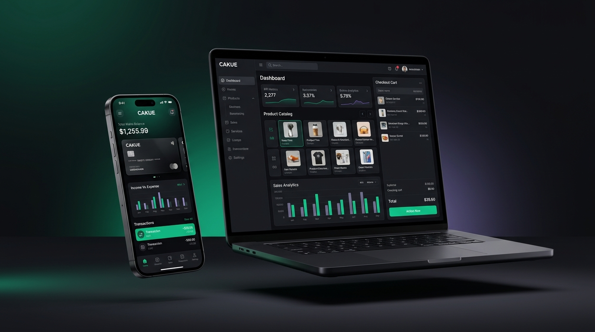

<p align="center">
  
</p>

<h1 align="center">CAKUE — Catatan Keuangan & Usaha Enterprise</h1>

<p align="center">
  <strong>Platform Finansial Dual-Domain Mandiri: Mobile Banking Personal & Multi-Outlet POS ERP Suite Berbasis Self-Hosted ($0 SaaS Fees)</strong>
</p>

<p align="center">
  <a href="https://github.com/thirza-rep/cakuev2/releases/latest"></a>
  <a href="https://github.com/thirza-rep/cakuev2/actions/workflows/build-apps.yml"></a>
  <a href="https://github.com/thirza-rep/cakuev2/blob/main/LICENSE"></a>
  <a href="#-status-riset--pengembangan-rd--lisensi-bebas-pakai"></a>
  <a href="https://cakue.codevits.site"></a>
</p>

<p align="center">
  
</p>

---

> [!NOTE]
> ### 🧪 STATUS RISET & PENGEMBANGAN (R&D) & LISENSI BEBAS PAKAI
> **CAKUE adalah proyek terbuka berstatus Research & Development (R&D) / Experimental Beta.**
> * 🆓 **100% Bebas Digunakan (Free to Use):** Siapa pun dipersilakan mengunduh, memakai, memodifikasi, dan meng-host (*self-hosted*) sistem ini secara mandiri untuk kebutuhan pencatatan keuangan pribadi maupun operasional bisnis UMKM tanpa dipungut biaya lisensi atau langganan ($0 SaaS Fee).
> * 🔬 **Eksplorasi R&D Berkelanjutan:** Proyek ini dikembangkan secara aktif sebagai riset integrasi antara akuntansi *double-entry* presisi (100% ACID di atas PostgreSQL 16), operasional POS multi-cabang tanpa cloud berbayar, dan pengiriman struk digital mandiri via WhatsApp Baileys.

---

## 📥 PUSAT UNDUHAN & AKSES APLIKASI (DOWNLOADS)

Pilih platform yang Anda gunakan untuk mengunduh aplikasi atau mengakses versi web:

| Platform | Berkas Instalasi | Ukuran | Status Rilis | Tautan Unduhan |
| :--- | :--- | :---: | :---: | :--- |
| **Android** | `app-debug.apk` | **~5.0 MB** | Stable R&D | [📲 **Download APK Android**](https://github.com/thirza-rep/cakuev2/releases/latest/download/app-debug.apk) |
| **Windows** | `CAKUE.Setup.1.0.0.exe` | **~90.7 MB** | Stable R&D | [💻 **Download Setup Windows (.exe)**](https://github.com/thirza-rep/cakuev2/releases/latest/download/CAKUE.Setup.1.0.0.exe) |
| **Web Cloud (PWA)**| `https://cakue.codevits.site` | Cloud | Online 24/7 | [🌐 **Buka Web App Langsung**](https://cakue.codevits.site) |
| **Semua Rilis** | Halaman Rilis GitHub | - | Arsip Lengkap | [📦 **Buka GitHub Releases**](https://github.com/thirza-rep/cakuev2/releases/latest) |

---

## 🔑 KREDENSIAL PENGUJIAN CEPAT (DEMO ACCOUNTS)

Untuk mencoba seluruh fitur tanpa perlu mendaftar dari awal:

| Peran Akun | Alamat Email | Kata Sandi | Deskripsi Hak Akses |
| :--- | :--- | :--- | :--- |
| **Super Admin (Root)** | `admin@cakue.id` | `admin123` | Otoritas penuh: kelola cabang, audit jurnal, supervisi tenant mitra, manajemen aset. |
| **Mitra Owner Usaha** | `budi.santoso@cakue.id` | `password123` | Pemilik bisnis Cabang 1 Malioboro: kasir POS, stok barang, buku kas operasional. |
| **Kasir Toko Jogja** | `kasir.jogja@cakue.id` | `password123` | Khusus operasional Kasir POS penjualan toko dan cetak struk. |
| **Staf Gudang Pusat** | `gudang.pusat@cakuenusantara.com` | `password123` | Khusus mutasi stok, penerimaan surat jalan logistik, dan stok opname. |

*(Anda juga dapat mendaftarkan akun baru secara gratis langsung dari aplikasi).*

---

## 🧭 DAFTAR ISI
1. [Filosofi Arsitektur & Prinsip $0 Cost](#1-filosofi-arsitektur--prinsip-0-cost)
2. [Pemisahan Dua Dunia Finansial (Dual-Domain)](#2-pemisahan-dua-dunia-finansial-dual-domain)
   - [A. Rana Personal (Cakue-Ku)](#a-rana-personal-cakue-ku)
   - [B. Rana Business (CAKUE ERP & POS Multi-Cabang)](#b-rana-business-cakue-erp--pos-multi-cabang)
3. [Alur Komersial: Onboarding, Google OAuth & RBAC](#3-alur-komersial-onboarding-google-oauth--rbac)
4. [Matriks Hak Akses Pengguna (Granular RBAC)](#4-matriks-hak-akses-pengguna-granular-rbac)
5. [Skema Database Lengkap (PostgreSQL 16 ACID)](#5-skema-database-lengkap-postgresql-16-acid)
6. [Katalog REST API Engine](#6-katalog-rest-api-engine)
7. [Infrastruktur Server, Docker & Panduan Deployment](#7-infrastruktur-server-docker--panduan-deployment)

---

## 1. FILOSOFI ARSITEKTUR & PRINSIP $0 COST

**CAKUE** dirancang untuk membuktikan bahwa solusi finansial dan sistem enterprise kelas dunia dapat dijalankan tanpa biaya langganan bulanan (*$0 SaaS Fee*):

1. **Nol Biaya Langganan (Zero Subscription Fees):** Seluruh infrastruktur berjalan secara mandiri (*self-hosted*) menggunakan Mini PC rumahan, Docker Engine, dan Cloudflare Tunnel tanpa perlu sewa VPS bulanan mahal.
2. **Kirim Struk WhatsApp Tanpa Biaya API:** Menggunakan microservice berbasis Baileys WebSockets yang langsung terhubung ke nomor WhatsApp toko, mengirimkan struk digital resmi ke pembeli dengan biaya Rp 0 per pesan.
3. **100% ACID Ledger (Bebas Halusinasi Data):** Seluruh pencatatan saldo dan mutasi kas menggunakan prinsip akuntansi Double-Entry berstandar SAK EMKM di atas database PostgreSQL 16.
4. **Rich Aesthetics & Clean Navigation:** Mengedepankan antarmuka modern (*Light/Dark responsive*), tipografi Inter & JetBrains Mono, 100% ikon vektor SVG tanpa emoji sistem operasi yang tidak formal, dan arsitektur *Sidebar Sub-Menu First* yang bebas dari tumpukan tombol di header.

---

## 2. PEMISAHAN DUA DUNIA FINANSIAL (DUAL-DOMAIN)

Untuk menjamin tidak ada percampuran dana antara kebutuhan rumah tangga dan operasional usaha, sistem memisahkan pengalaman pengguna menjadi 2 portal mutlak:

### A. Rana Personal (Cakue-Ku)
* **Gaya Visual:** Aplikasi Mobile Banking modern (mirip BCA Mobile, Livin', atau Jenius).
* **Fitur Utama:**
  * **Manajemen Multi-Rekening:** Pengelompokan kas fisik tunai, rekening bank (BCA, Mandiri, BRI), dan e-wallet (GoPay, OVO, ShopeePay) dengan saldo bersih mandiri.
  * **Catat Pengeluaran & Pemasukan Cepat:** Modal instan responsif untuk pencatatan transaksi harian dan mutasi QRIS.
  * **Manajemen Utang & Piutang:** Riwayat cicilan, progress bar pelunasan, dan status jatuh tempo.
  * **Alokasi Kantong Anggaran (50/30/20):** Pembagian otomatis antara kebutuhan primer (*Needs 50%*), keinginan (*Wants 30%*), dan tabungan/investasi (*Savings 20%*).
  * **Ekspor Laporan Mutasi Excel:** Ekspor data mutasi kas ke spreadsheet Microsoft Excel (`.xls`) dan CSV bersih.

### B. Rana Business (CAKUE ERP & POS Multi-Cabang)
* **Gaya Visual:** Modern Enterprise SaaS & ERP Suite dengan navigasi bersarang (*Anti-Clutter Constitution*).
* **Fitur Utama:**
  * **Kasir POS Toko Layar Sentuh (`PosCashier.vue`):** Katalog produk visual, pencarian SKU instan, integrasi barcode scanner, multi-metode pembayaran (Tunai, QRIS, Transfer Bank), kalkulator uang kembalian, dan cetak struk thermal 58mm/80mm.
  * **Kirim Struk Otomatis via WhatsApp:** Pengiriman struk digital format teks profesional via Baileys WA Gateway ($0 Cost).
  * **Inventaris Multi-Cabang & Gudang Pusat:** Pengawasan stok di 6 cabang aktif wilayah Yogyakarta + Gudang Pusat Sleman, dengan sistem Surat Jalan Pengiriman stok (*Draft* $\rightarrow$ *In-Transit* $\rightarrow$ *Received*).
  * **Manajemen Aset Tetap & Depresiasi:** Inventarisasi aset fisik perusahaan dan kalkulasi beban penyusutan garis lurus bulanan otomatis.
  * **Buku Besar Akuntansi Double-Entry:** Jurnal umum dengan debit dan kredit seimbang (zero-difference guarantee) di atas PostgreSQL 16.
  * **Supervisi Tenant (Khusus Super Admin):** Fitur audit akun pemilik usaha mitra tanpa mencampuradukkan data transaksi antar tenant.

---

## 3. ALUR KOMERSIAL: ONBOARDING, GOOGLE OAUTH & RBAC

Aplikasi CAKUE menerapkan standar onboarding komersial 4 tahap yang aman dan terstruktur:

```
+-----------------------------------------------------------------------------------+
| 1. ONBOARDING & PILIH DUNIA AKSES (OnboardingView.vue)                            |
|    - Pilih: Catat Keuangan Pribadi (personal) ATAU SaaS ERP Usaha (business)      |
|    - Autentikasi: Login Form Email/Password ATAU Akun Google                      |
+----------------------------------------+------------------------------------------+
                                         |
                                         v
+-----------------------------------------------------------------------------------+
| 2. GOOGLE OAUTH 2.0 TOKEN VERIFICATION (POST /api/auth/google)                     |
|    - Validasi token ID Google via Google Public API Client ID                     |
|    - Jika User Lama: Langsung login -> Masuk ke Dashboard Sesuai Rana              |
|    - Jika User Baru: Kirim status is_new = true -> Setup Username & Password      |
+----------------------------------------+------------------------------------------+
                                         |
                                         v
+-----------------------------------------------------------------------------------+
| 3. SETUP KREDENSIAL GANDA (GoogleCredentialModal.vue)                             |
|    - Username unik (@username, min 3 karakter, alfanumerik & underscore)          |
|    - Kata Sandi ganda (minimal 6 karakter kombinasi huruf dan angka)              |
|    - POST /api/auth/register-google -> Simpan password hash (Bcrypt Safe)         |
+----------------------------------------+------------------------------------------+
                                         |
                                         v
+-----------------------------------------------------------------------------------+
| 4. ISOLASI DATA INSTAN (ZERO DATA LEAKAGE)                                       |
|    - Akun Personal Baru: Saldo awal Rp 0, 0 transaksi, portal dompet bersih       |
|    - Akun Bisnis Baru: Dialokasikan ke cabang mandiri, katalog produk baru         |
+-----------------------------------------------------------------------------------+
```

---

## 4. MATRIKS HAK AKSES PENGGUNA (GRANULAR RBAC)

Sistem menerapkan penegakan wewenang mutlak (*Role-Based Access Control*):

| Fitur / Modul Operasional | Super Admin | Owner (Direktur) | Manajer Cabang | Kasir POS Toko | Staff Gudang | Nasabah Personal |
| :--- | :---: | :---: | :---: | :---: | :---: | :---: |
| **Pilihan Portal Aktif** | Business | Business | Business | Business | Business | Personal |
| **Ringkasan KPI & Omset** | ✅ Penuh | ✅ Penuh | 🔒 Cabang Sendiri | ❌ Diblokir | ❌ Diblokir | ❌ N/A |
| **Kasir POS Toko (`pos`)** | ✅ Semua Cabang | ✅ Semua Cabang | ✅ Cabang Sendiri | ✅ Terkunci Cabang | ❌ Diblokir | ❌ N/A |
| **Inventaris & Logistik** | ✅ Semua Cabang | ✅ Semua Cabang | ✅ Cabang & Gudang | ❌ Diblokir | ✅ Gudang (Masking HPP)| ❌ N/A |
| **Manajemen Aset Tetap** | ✅ Penuh | ✅ Penuh | ❌ Diblokir | ❌ Diblokir | ❌ Diblokir | ❌ N/A |
| **Eksekusi Depresiasi Aset** | ✅ Berwenang | ✅ Berwenang | ❌ Diblokir | ❌ Diblokir | ❌ Diblokir | ❌ N/A |
| **Buka/Tutup Cabang Baru** | ✅ Berwenang | ✅ Berwenang | ❌ Diblokir | ❌ Diblokir | ❌ Diblokir | ❌ N/A |
| **Ubah Harga Master Produk** | ✅ Berwenang | ✅ Berwenang | ❌ Diblokir | ❌ Diblokir | ❌ Diblokir | ❌ N/A |
| **Sinkronisasi Stok ke Kas** | ✅ Berwenang | ✅ Berwenang | ✅ Berwenang | ❌ Diblokir | ❌ Diblokir | ❌ N/A |
| **Manajemen Tim & Staf** | ✅ Semua Cabang | ✅ Semua Cabang | ✅ Staf Cabangnya | ❌ Diblokir | ❌ Diblokir | ❌ N/A |
| **Pengaturan Pajak & Brand** | ✅ Berwenang | ✅ Berwenang | 🔒 Read-Only | ❌ Diblokir | ❌ Diblokir | ❌ N/A |
| **Supervisi Akun Tenant** | ✅ Berwenang | ❌ N/A | ❌ N/A | ❌ N/A | ❌ N/A | ❌ N/A |

---

## 5. SKEMA DATABASE LENGKAP (POSTGRESQL 16 ACID)

Database PostgreSQL berjalan di container Docker `cakue-postgres` pada port internal `5432` (diexpose ke port host `5433`).

```sql
-- 1. CABANG USAHA & GUDANG PUSAT
CREATE TABLE IF NOT EXISTS branches (
    id VARCHAR(50) PRIMARY KEY,
    name VARCHAR(100) NOT NULL,
    type VARCHAR(20) NOT NULL CHECK (type IN ('warehouse', 'branch')),
    address TEXT,
    created_at TIMESTAMP DEFAULT CURRENT_TIMESTAMP
);

-- 2. USER SESSIONS, KEAMANAN & OTENTIKASI (RBAC)
CREATE TABLE IF NOT EXISTS users (
    id VARCHAR(50) PRIMARY KEY,
    username VARCHAR(50) UNIQUE,
    email VARCHAR(100) UNIQUE NOT NULL,
    name VARCHAR(100) NOT NULL,
    phone VARCHAR(30),
    phone_verified BOOLEAN DEFAULT TRUE,
    otp_code VARCHAR(10),
    otp_expires_at TIMESTAMP,
    is_profile_complete BOOLEAN DEFAULT TRUE,
    password_hash VARCHAR(255),
    account_type VARCHAR(20) NOT NULL CHECK (account_type IN ('personal', 'business')),
    role VARCHAR(30) NOT NULL CHECK (role IN ('superadmin', 'owner', 'manager', 'cashier', 'warehouse', 'personal')),
    branch_id VARCHAR(50) REFERENCES branches(id),
    avatar_url TEXT,
    created_at TIMESTAMP DEFAULT CURRENT_TIMESTAMP,
    last_login TIMESTAMP
);

-- 3. MASTER PRODUK & KATALOG
CREATE TABLE IF NOT EXISTS products (
    id VARCHAR(50) PRIMARY KEY,
    sku VARCHAR(50) UNIQUE NOT NULL,
    name VARCHAR(150) NOT NULL,
    category VARCHAR(50) NOT NULL,
    cost_price NUMERIC(15, 2) NOT NULL,
    selling_price NUMERIC(15, 2) NOT NULL,
    min_alert_qty INT DEFAULT 10,
    created_at TIMESTAMP DEFAULT CURRENT_TIMESTAMP
);

-- 4. INVENTORY MOVEMENT LEDGER (Mutasi Stok Presisi)
CREATE TABLE IF NOT EXISTS inventory_ledger (
    id BIGSERIAL PRIMARY KEY,
    product_id VARCHAR(50) REFERENCES products(id),
    branch_id VARCHAR(50) REFERENCES branches(id),
    change_qty INT NOT NULL,
    reference_type VARCHAR(50) NOT NULL,
    reference_id VARCHAR(100),
    notes TEXT,
    created_at TIMESTAMP DEFAULT CURRENT_TIMESTAMP
);

-- 5. SURAT JALAN & TRANSFER ANTAR CABANG
CREATE TABLE IF NOT EXISTS stock_transfers (
    id VARCHAR(50) PRIMARY KEY,
    from_branch_id VARCHAR(50) REFERENCES branches(id),
    to_branch_id VARCHAR(50) REFERENCES branches(id),
    driver_name VARCHAR(100),
    status VARCHAR(20) NOT NULL CHECK (status IN ('DRAFT', 'IN_TRANSIT', 'RECEIVED')),
    created_at TIMESTAMP DEFAULT CURRENT_TIMESTAMP,
    received_at TIMESTAMP
);

-- 6. DOUBLE-ENTRY FINANCIAL BOOKKEEPING
CREATE TABLE IF NOT EXISTS accounts (
    id VARCHAR(50) PRIMARY KEY,
    name VARCHAR(100) NOT NULL,
    type VARCHAR(30) NOT NULL CHECK (type IN ('CASH', 'BANK', 'EWALLET', 'RECEIVABLE', 'PAYABLE', 'EQUITY', 'REVENUE', 'EXPENSE')),
    current_balance NUMERIC(15, 2) DEFAULT 0.00
);

CREATE TABLE IF NOT EXISTS journal_entries (
    id BIGSERIAL PRIMARY KEY,
    transaction_date DATE NOT NULL,
    description TEXT NOT NULL,
    reference_no VARCHAR(100),
    created_at TIMESTAMP DEFAULT CURRENT_TIMESTAMP
);

CREATE TABLE IF NOT EXISTS journal_lines (
    id BIGSERIAL PRIMARY KEY,
    journal_id BIGINT REFERENCES journal_entries(id) ON DELETE CASCADE,
    account_id VARCHAR(50) REFERENCES accounts(id),
    debit NUMERIC(15, 2) DEFAULT 0.00,
    credit NUMERIC(15, 2) DEFAULT 0.00
);
```

---

## 6. KATALOG REST API ENGINE

### A. API Autentikasi & Pengguna
* `POST /api/auth/login` — Autentikasi email/username dan kata sandi (Bcrypt verified).
* `POST /api/auth/register` — Pendaftaran akun manual (Personal atau Business).
* `POST /api/auth/google` — Verifikasi Google ID Token & Sign-in.
* `POST /api/auth/register-google` — Registrasi akun baru dari kredensial Google.
* `POST /api/auth/upgrade-business` — Upgrade akun personal ke akun usaha (membuat cabang baru).
* `PUT /api/auth/update-profile` — Pembaruan nama & foto profil (dilindungi IDOR protection).

### B. API Operasional & Transaksi
* `GET /api/health` — Cek status koneksi server, database PostgreSQL, dan WA Gateway.
* `GET /api/branches` — Daftar master cabang aktif.
* `GET /api/products` — Master produk beserta kalkulasi total mutasi stok.
* `GET /api/transactions` — Riwayat jurnal transaksi double-entry akuntansi.
* `POST /api/whatsapp/send-receipt` — Mengirimkan struk kasir POS resmi via WhatsApp Baileys.

---

## 7. INFRASTRUKTUR SERVER, DOCKER & PANDUAN DEPLOYMENT

### A. Pemetaan Port Container Home Server (192.168.1.13)
* **Frontend Web App (Nginx SPA):** `0.0.0.0:5173` $\rightarrow$ Container port `80`
* **Backend REST API (Node Express):** `0.0.0.0:3001` $\rightarrow$ Container port `3001`
* **WhatsApp Gateway (Baileys):** `0.0.0.0:3333` $\rightarrow$ Container port `3333`
* **PostgreSQL Database Engine:** `0.0.0.0:5433` $\rightarrow$ Container port `5432`
* **Adminer Web Database GUI:** `0.0.0.0:8088` $\rightarrow$ Container port `8080`

### B. Menjalankan Server Mandiri (Docker Compose)
```bash
git clone https://github.com/thirza-rep/cakuev2.git
cd cakuev2
docker compose -f docker-compose.server.yml up -d --build
```

### C. Alur Build Android APK di Mesin Lokal
```bash
cd frontend
npm install
npm run build
npx cap sync android
cd android && ./gradlew assembleDebug
```
*File APK hasil build akan berlokasi di: `frontend/android/app/build/outputs/apk/debug/app-debug.apk`.*

---

<p align="center">
  Dibuat dengan ❤️ oleh <a href="https://github.com/thirza-rep"><strong>Thirza-rep</strong></a> & Komunitas Pengembang CAKUE.<br/>
  <em>Bebas digunakan untuk kemandirian finansial dan digitalisasi UMKM Indonesia ($0 SaaS Cost).</em>
</p>
